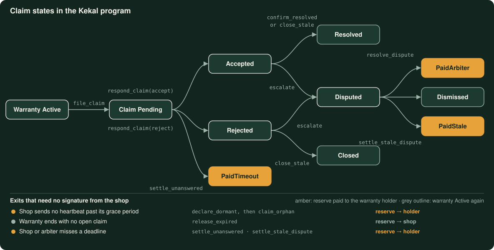
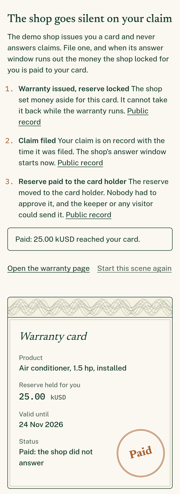

<p align="center"></p>

<h1 align="center">Kekal</h1>

<p align="center">  <br>
<a href="#run-it-yourself">Run it</a> · <a href="#limits">Limits</a> · <a href="#bahasa-melayu">Bahasa Melayu</a></p>

**The warranty that outlives the shop.** For each sale a shop locks a small reserve in a Solana program. If the shop goes
silent, the buyer is paid.

Submitted to the Dev3pack Global Hackathon (27–29 Nov 2026). Built in Malaysia by Aiman Malib.
Ringkasan Bahasa Melayu: see the last section, [Bahasa Melayu](#bahasa-melayu).

## Why

I write the software for a small solar shop in Malaysia. Every quotation it prints carries a warranty certificate. The
manufacturer stands behind the panel. The shop stands behind the rest: the installation, and being there when something
fails. That part is a promise on paper. If the shop closes, nobody is left to keep it.

In the UK the same gap is closed with insurance: certified solar installers must insure their workmanship guarantee so it
"will be honoured if your company ceases to trade"
([MCS](https://mcscertified.com/installers/help-resources/insurance-backed-guarantee-products/)). Kekal does that job with a
program instead of an insurer.

## How it works

The program holds the reserve, not the shop. It enforces three rules.

1. The shop does not answer a claim in time: the reserve is paid to the buyer.
2. The shop stops sending its heartbeat: it is marked dormant and every live warranty can be paid out.
3. The warranty ends with no open claim: the reserve returns to the shop.

A rejected claim can go to a named arbiter. If the arbiter does not decide in time, the buyer is paid. Every state has an
exit that needs no signature from the shop or the buyer.

Only the shop holds crypto. The buyer gets a QR card, needs no wallet and pays no fees.



The diagram follows the status values in [`programs/kekal/src/state.rs`](programs/kekal/src/state.rs). The shop picks its
own windows (time to answer, time to repair, time to dispute, heartbeat interval and grace) when it is created, inside limits
held in a config account. No instruction changes them afterwards, so a buyer can read the rules before trusting the card.

The money side is plain SPL tokens. A shop deposits a stablecoin into a vault owned by the program. Issuing a warranty moves
the reserve from the shop's free balance into that warranty's locked amount, and the shop can only withdraw the free part.
When a warranty is paid out, the locked amount goes to the token account of the current holder. When it is released, it goes
back to the free balance.

The parts around the program (web app, fee relayer, keeper) and the money flow are drawn in
[`docs/ARCHITECTURE.md`](docs/ARCHITECTURE.md). The threat model, invariants and review findings are in
[`docs/SECURITY.md`](docs/SECURITY.md).

## Status

- **Program:** 20 instructions, built with Anchor 1.2.2, deployed on devnet at
  [`3dTk2T83xQWAat7iWDjfCzijdCQWhstUxFtwLk8HUo3X`](https://explorer.solana.com/address/3dTk2T83xQWAat7iWDjfCzijdCQWhstUxFtwLk8HUo3X?cluster=devnet).
  All five paths below pass on devnet; every transaction is linked on the [measurements page](docs/MEASURED.md). The deploy key
  is the upgrade authority, so the program can still be upgraded on devnet.
- **Web app:** runs at [kekal.sasateguh.com](https://kekal.sasateguh.com) but is not switched to devnet yet, so the
  no-wallet demo is closed for now. The demo, the buyer's warranty page, the shop board and the arbiter board are tested on
  a local validator, in English and Bahasa Melayu.
- **Video:** not recorded yet.

## Try it

The quickest look today is the lifecycle script. It starts a throwaway local validator with the built program, creates a
config, a demo stablecoin, a shop and five warranties, then walks each warranty down one path and checks the final state on
chain:

| Path | What happens | Ends as |
|------|--------------|---------|
| A | Buyer claims, shop accepts, buyer confirms the repair | claim Resolved, warranty Active |
| B | Buyer claims, shop stays silent past its window, anyone settles | reserve paid to the buyer |
| C | Shop stops its heartbeat, anyone declares it dormant, the buyer is paid | reserve paid to the buyer |
| D | Warranty ends with no claim, anyone releases it | reserve back to the shop |
| E | Shop rejects, buyer escalates, the arbiter rules for the buyer | reserve paid to the buyer |

The same paths B and C also run in a browser on the web app's `/demo` page, with no wallet. This capture is
WebKit emulating an iPhone 13 at the end of path B, taken by the browser tests below against a local validator:



## Run it yourself

You need Rust, the Solana CLI (Agave) 4.3.2, Anchor 1.2.2 (via `avm`), Node 22.12 or later and pnpm. The exact versions are pinned in
[ADR 0001](docs/decisions/0001-toolchain.md) and `rust-toolchain.toml`.

```bash
git clone https://github.com/aimanmalib/kekal && cd kekal
anchor build                                    # builds target/deploy/kekal.so and the IDL
cargo test -p kekal                             # program tests in LiteSVM (needs the build above)
pnpm install --frozen-lockfile && pnpm test     # SDK and script tests (Vitest)
bash scripts/localnet.sh                        # paths A to E on a throwaway local validator
```

`scripts/localnet.sh` reads its ports from [`config/app.json`](config/app.json) (RPC 18899) and removes its ledger when it
exits. Each command above was run once, in order, from a clean archive of this repository on Linux x86-64, and each exited
with status 0; the counts are in the next section. The first `anchor build` compiles every dependency and takes a while.

## Tests

| Suite | Where | Count | Result |
|-------|-------|-------|--------|
| Program tests (LiteSVM, fixed clock, no sleeps) | `programs/kekal/tests/` | 72 | pass |
| SDK tests (PDAs, instruction builders, decoders, hashing vectors) | `packages/sdk/test/` | 55 | pass |
| Web app tests (RPC proxy, fee relayer, sessions, request limits, demo, warranty page, shop board, cards, locales, program status, home page, form images) | `apps/web/test/` | 251 | pass |
| Script tests (cluster config, locales, how warranties are issued, deploy checks, RPC pacing) | `scripts/test/` | 22 | pass |
| Keeper tests (heartbeats, dormant shops, due settling steps) | `apps/keeper/test/` | 9 | pass |
| Deploy script tests (uptime alerts, image smoke test, proxy route template) | `scripts/test/deploy.test.sh` | 9 | pass |
| Video cut tests (narration timing, subtitle splitting, cut file) | `scripts/video/test_cut.py` | 10 | pass |
| Server package tests (store on SQLite, keys, RPC failover) | `packages/server/test/` | 14 | pass |
| Store tests on a throwaway Postgres container | `scripts/test-postgres.sh` | 9 | pass |
| Lifecycle paths A to E on a local validator | `scripts/lifecycle.ts` | 5 | pass |
| Lifecycle paths A to E on devnet ([transactions](docs/MEASURED.md)) | `scripts/lifecycle.ts --cluster devnet` | 5 | pass |
| Browser tests (Playwright: Chromium desktop and WebKit iPhone 13) | `e2e/tests/` | 5 per browser | pass |

The program tests set the clock directly, so every deadline is checked on both sides of its edge: answering at the last
second of the window passes, one second later fails, and settling for silence fails at that same last second and passes one
second later. The property tests run seeded random walks of 200 instructions and check four invariants after every step: the vault
holds at least the shop's free plus locked balance; the locked balance equals the reserves of live warranties; every reserve
ever issued is either still locked, paid or released, and a paid or released warranty never changes again; and anything a
stranger tries (claim, transfer, escalation, withdrawal) fails and changes nothing. A liveness test checks that each open
state's exit is refused one second early and accepted on time. The attack tests try another shop's vault, a fake mint, a
warranty paired with the wrong shop, a second payout by another route, a missing signature, a former holder, extreme
windows and amounts, and a deposit in the wrong mint.

The browser tests start their own local validator, sample warranties and test wallets, serve the built web app and then
drive it: path B and path C on `/demo` until the reserve is paid; on `/kedai` a seller with an injected test wallet opens a
shop, deposits, checks in and issues a card (the PDF and both PNG cards are downloaded and checked), the buyer activates it
on a phone and claims, the shop rejects, the buyer escalates and the arbiter pays the buyer on `/timbang`; and every page in
English and Bahasa Melayu at 390 and 320 px wide must not scroll sideways. Run them with `bash scripts/e2e.sh` after
`anchor build`; the port, widths and pages are in [`config/e2e.json`](config/e2e.json).

## Instructions

| # | Instruction | Signed by | What it does |
|---|-------------|-----------|--------------|
| 1 | `init_config` | first caller (becomes admin) | Creates the config: window limits, allowed mints, pause flag |
| 2 | `set_config` | admin | Changes the limits, the allowed mints and the pause flag (pause stops new shops and warranties only) |
| 3 | `create_shop` | shop owner | Creates the shop, its vault and its windows; names an arbiter or takes the config's default |
| 4 | `update_shop_profile` | shop owner | Replaces the hash of the shop's public profile |
| 5 | `deposit` | shop owner | Moves stablecoin into the shop's vault (free balance) |
| 6 | `withdraw` | shop owner | Takes free balance back; locked reserves cannot move |
| 7 | `issue_warranty` | shop owner | Locks a reserve for one sale and names the holder key on the QR card |
| 8 | `heartbeat` | shop owner | Proves the shop is alive and pushes back the dormant deadline |
| 9 | `transfer_holder` | holder | Hands the warranty to a new key, for example when the product is sold |
| 10 | `file_claim` | holder | Opens a claim with the hash of the evidence |
| 11 | `respond_claim` | shop owner | Accepts (repair window starts) or rejects (dispute window starts) |
| 12 | `confirm_resolved` | holder | Confirms the repair; the warranty is Active again |
| 13 | `escalate` | holder | Sends a rejected claim, or an unfinished repair, to the arbiter |
| 14 | `resolve_dispute` | arbiter | Rules for the buyer (paid) or for the shop (dismissed) |
| 15 | `settle_unanswered` | anyone | Pays the holder when the shop missed the answer window |
| 16 | `close_stale` | anyone | Closes a claim nobody escalated in time; the warranty is Active again |
| 17 | `settle_stale_dispute` | anyone | Pays the holder when the arbiter missed its deadline |
| 18 | `declare_dormant` | anyone | Marks a shop dormant once heartbeat plus grace has passed |
| 19 | `claim_orphan` | anyone | Pays the holder of a live warranty from a dormant shop |
| 20 | `release_expired` | anyone | Returns the reserve of an ended, unclaimed warranty to the shop |

There is no `close` instruction for warranties or claims: a record stays on chain so a buyer can always look it up. Why each
rule looks the way it does is written down in the [decision records](docs/DECISIONS.md).

## Built before vs during

The Dev3pack Global Hackathon runs 27–29 Nov 2026. Everything below was built before the event; the commit history is the
record.

| Dates (2026) | What | Commits |
|--------------|------|---------|
| 13 Nov | Repository, license, name check, toolchain pin (Anchor 1.2.2) | `d982bb6` to `6b582b3` |
| 13 Nov | Program accounts and instructions 1–14 with LiteSVM tests | `bf3a80c` to `f67fa99` |
| 14 Nov | Instructions 15–20 (settlement that needs no signature, dormant shop, expiry) | `6bc52fc`, `94f00bd` |
| 14 Nov | Property, liveness and attack tests (72 program tests in total) | `6a3b2ec`, `86e94c9` |
| 14 Nov | pnpm workspace, TypeScript SDK, lifecycle script for paths A to E | `6877e23` to `76c1afb` |
| 15–18 Nov | Build housekeeping (sweeping old cargo artifacts) | `07519bb` to `aa4c03e` |
| 22 Nov | Lifecycle fix (heartbeat and issue in one transaction for the dying shop), this README, diagram and capture | `6489873`, `93d7659` |
| 22 Nov | Web app skeleton (Next.js, locales, RPC proxy, store), fee relayer and wallet sessions | `90303be` to `b535cc7` |
| 23 Nov | AI_USAGE.md and link previews | `ce77658` to `3155278` |
| 23 Nov | Server package, keeper, no-wallet demo API and `seed-demo` | `d409976` to `cacb6d2` |
| 23 Nov | Warranty page `/w`, read-only `/semak`, guided `/demo` and `/contoh` | `1bdd3ce` to `0b308b3` |
| 23 Nov | Shop board `/kedai`, arbiter board `/timbang`, printed cards | `a5852d7` to `ee75e0e` |
| 23 Nov | Browser end-to-end tests (Chromium and WebKit iPhone 13) and the `/demo` capture above | `b9519a1` to `bd33c97` |

Work done during the event will be added to this table with its commits.

## Related work

- [Resvyn](https://github.com/mystiquemide/resvyn) (BOT Chain): a merchant funds a warranty reserve before coverage is
  issued, and an evaluator signs each claim decision that the contract verifies.
- [Warrantoken](https://github.com/Warrantoken/warrantoken-contract) (Ethereum): warranties registered on chain and looked up
  by QR code.
- [Soroban warranty tracker](https://github.com/sharifmdathar/soroban-warranty-tracker) (Stellar): a registry that tracks
  product warranties in a Soroban contract.
- [POP, Proof of Purchase](https://base-batch-india.devfolio.co/projects/pop-warranty-bafc) (Base): warranty records as
  on-chain tokens, with no reserve behind them.

Where Kekal differs: silence pays (no evaluator or oracle decides a claim the shop ignores), a dormant-shop switch pays every
live warranty, the buyer holds a QR bearer key with no wallet and no fees, and every state has an exit with a deadline.

## Limits

The full list, with the threat model behind it, is in [`docs/SECURITY.md`](docs/SECURITY.md).

- **Devnet only.** The program has not been audited. Do not use it with real money.
- **No cash-out to ringgit.** A buyer who is paid receives a stablecoin on a key; turning that into ringgit is outside the
  program.
- **The arbiter is trusted.** The shop names it, or takes the default arbiter in the config. The program only makes sure the arbiter cannot be the shop owner and
  that an arbiter who does nothing still loses to the deadline.
- **`init_config` is taken by its first caller.** Whoever calls it first after a deploy becomes the admin. It is not yet
  tied to the program's upgrade authority; the deploy script calls it right after the deploy and stops unless the deploy
  key is the admin, which it is on devnet.
- **Someone has to send the settling transactions.** The exits need no signature from the shop or the buyer, but a
  transaction still has to be sent. If no keeper or person sends it, the money waits in the vault until someone does.
- **The shop must hold a stablecoin and lock capital.** That is a real cost for a small shop, and the reserve per sale is a
  shop decision.
- **The QR card is a bearer key.** Whoever holds the card can claim. A lost card can be moved to a new key with
  `transfer_holder` only while the old key is still at hand.

## AI disclosure

I write software for small businesses in Malaysia. Rust and Solana are new to me. The design, code, tests and this README
were produced with AI coding agents (Claude Code) that I run on my own server, and checked by separate AI review sessions.
I am responsible for this project. [AI_USAGE.md](AI_USAGE.md) lists the tools, what the AI produced, what I did,
how the work was checked and the limits of that review.

## License

MIT. See [LICENSE](LICENSE).

## Bahasa Melayu

**Kekal: waranti yang kekal walaupun kedai tiada lagi.** Bagi setiap jualan, kedai mengunci sedikit rizab dalam program Solana.
Program itu, bukan kedai, yang memegang wang tersebut dan menguatkuasakan tiga peraturan:
1. Kedai tidak menjawab tuntutan dalam tempoh yang ditetapkan: rizab dibayar kepada pembeli.
2. Kedai berhenti menghantar degupan: kedai ditanda dorman dan setiap waranti yang masih hidup boleh dibayar.
3. Waranti tamat tanpa tuntutan terbuka: rizab pulang kepada kedai.
Pembeli hanya memegang kad QR; tiada dompet, tiada yuran. Tuntutan yang ditolak boleh dibawa kepada penimbang tara bernama.
Keadaan kini: program sudah dipasang di devnet (alamat di atas) dan kelima-lima laluan lulus di sana; laman sudah hidup
tetapi belum ditukar ke devnet, jadi demo tanpa dompet masih ditutup. Hanya untuk devnet.
Butiran penuh, arahan menjalankan dan had projek ada dalam bahagian bahasa Inggeris di atas. Lesen MIT.
