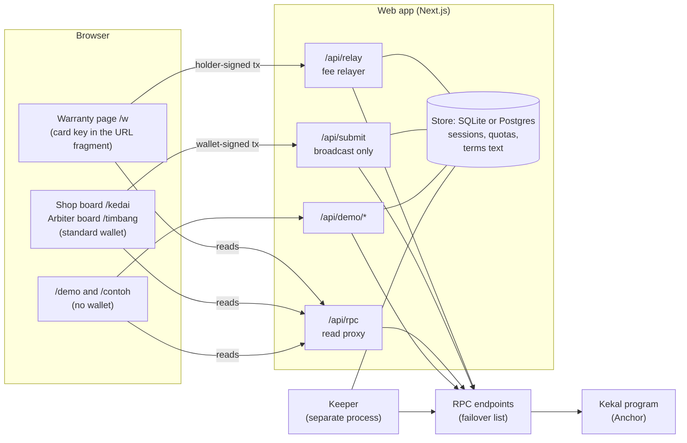
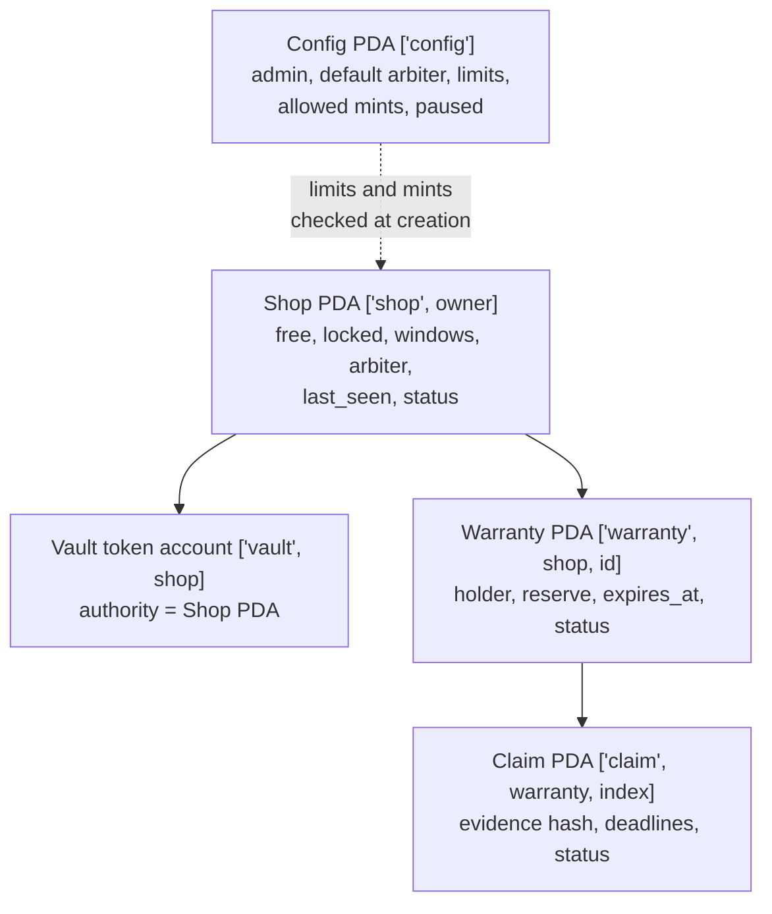
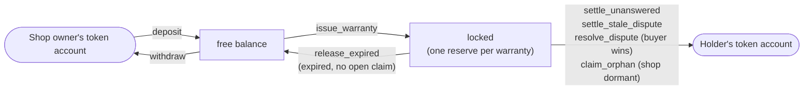

# Architecture

Kekal has one on-chain program and three off-chain parts around it. The program holds the money and enforces every rule.
The off-chain parts pay fees, send transactions that fall due and show the state; none of them can move a reserve on
their own.

## Components

| Part | Code | What it does | Keys it holds |
| --- | --- | --- | --- |
| Program | `programs/kekal` | Shops, vaults, warranties, claims, disputes, dormancy, payouts. 20 instructions. | none (PDAs sign) |
| SDK | `packages/sdk` | IDL, account layouts, PDA helpers, instruction builders, status names. Used by every other part. | none |
| Server package | `packages/server` | Store interface (SQLite, or Postgres by `DATA_BACKEND`; ADR 0022), cluster settings, RPC failover, key loading by role, demo chain steps. | loads by role name |
| Web app | `apps/web` | Pages, relayer, broadcast endpoint, read proxy, demo API, wallet sessions. | relayer, demo seller, demo arbiter |
| Keeper | `apps/keeper` | Every few seconds: heartbeats the demo shop, declares lapsed shops dormant, sends each due permissionless step. | relayer (fee payer only) |

Values the parts read (windows, limits, allowed instructions, quotas, RPC list, intervals) live in `config/app.json`.
Text lives in `locales/`. Decisions are in [`docs/decisions/`](decisions/).

## Program accounts

- The vault's authority is the shop PDA, so only the program can sign a transfer out of it.
- Accounting never reads the vault's token balance; it keeps `free` and `locked` on the shop record (invariant I1 in
  [SECURITY.md](SECURITY.md)).
- A shop's arbiter is fixed when the shop is created; the owner cannot swap it during a dispute.

## Where the money goes

Both `free` and `locked` sit in the same vault; the split is bookkeeping on the shop record. A reserve leaves `locked`
exactly once: to the holder in full, or back to `free` after expiry. There is no partial payout.

## Who sends what

| Instruction group | Signed by | Fee paid by | Path |
| --- | --- | --- | --- |
| Config (1, 2) | admin | admin | deploy script |
| Shop owner (3 to 8, 11) | owner's wallet | owner | `/kedai` → `/api/submit` |
| Holder (9, 10, 12, 13) | card key | relayer | `/w` → `/api/relay` |
| Arbiter (14) | arbiter's wallet | arbiter | `/timbang` → `/api/submit` |
| Permissionless (15 to 20) | anyone | sender | keeper, or anyone through `/api/relay` |

Numbers follow the instruction order in `programs/kekal/src/lib.rs` (1 = `init_config`). The relayer signs only as fee
payer and in the rent-payer slots its policy names; `/api/submit` adds no signature at all.

## Claim lifecycle

The claim state diagram is [`docs/media/states.svg`](media/states.svg); the rules behind each transition are in
[ADR 0003](decisions/0003-claims-and-disputes.md) and [ADR 0004](decisions/0004-permissionless-settlement.md).
Every non-final state has an exit that needs no signature from the shop or the buyer once its deadline passes.

## Deployment

The web app and the keeper run as two containers from one image, both read-only with a shared data volume for the
SQLite store and role keys mounted read-only from the host. The image carries no Rust toolchain: the program is built
and deployed from a workstation with `scripts/deploy-program.sh`, which calls `init_config` in the same run. See
[ADR 0016](decisions/0016-deploy-and-program-not-deployed.md) and [ADR 0017](decisions/0017-devnet-deploy.md).
